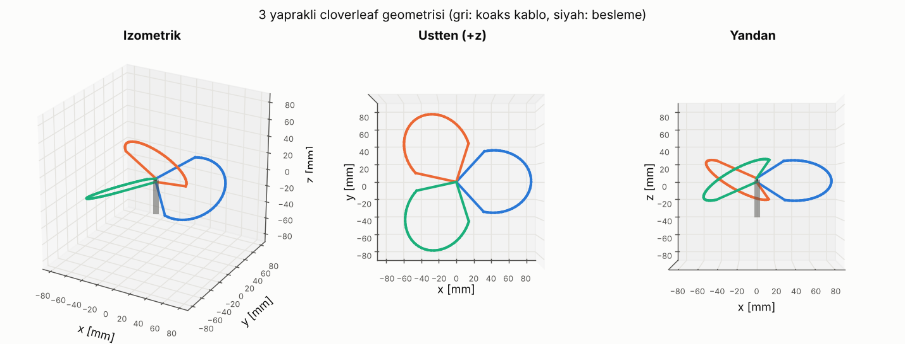
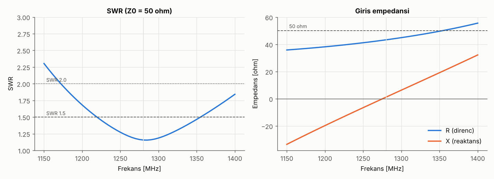
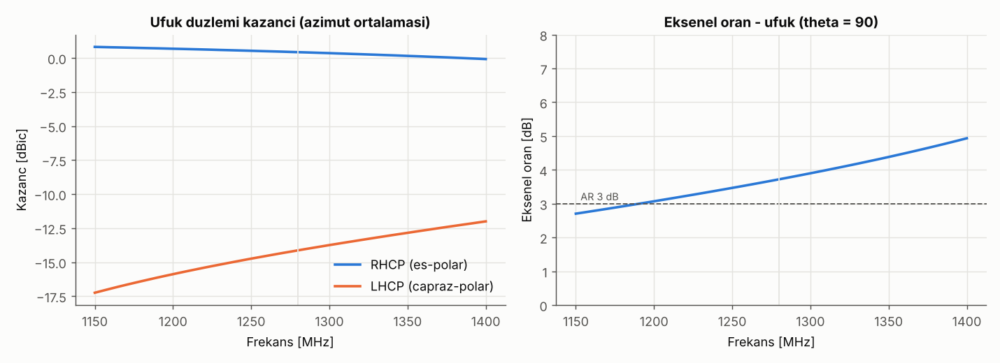
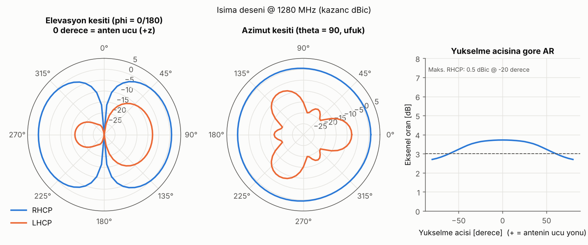
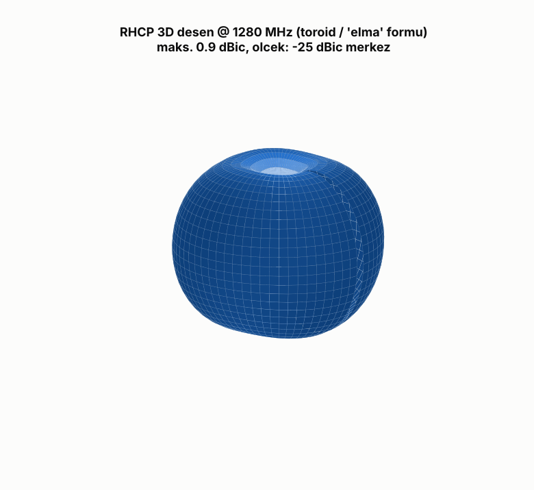
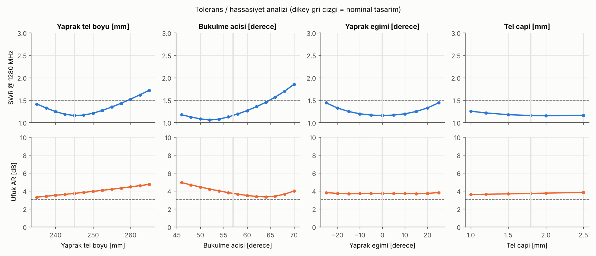
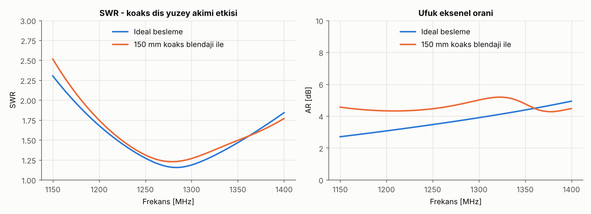

# 3 Yapraklı Cloverleaf Anten — 1.2–1.3 GHz, RHCP

1.2/1.3 GHz analog FPV video bandı için **3 yapraklı (3-lobe) cloverleaf** dairesel polarizasyonlu anten tasarımı.
Tasarım NEC2 ile modellenip optimize edildi; tüm modeller **4nec2** ile doğrudan açılabilir, tüm analizler Python betikleriyle yeniden üretilebilir.



## Özet sonuçlar (simülasyon, f0 = 1280 MHz)

| Parametre | Değer |
|---|---|
| Polarizasyon | RHCP (sağ el dairesel) |
| Giriş empedansı | 43.4 + j1.2 Ω |
| SWR @ 1280 MHz | 1.16 |
| SWR ≤ 1.5 bandı | 1220 – 1350 MHz (~%10) |
| SWR ≤ 2.0 bandı | 1175 – 1400+ MHz |
| RHCP kazanç (ufuk, azimut ort.) | +0.4 dBic |
| Azimut dalgalanması (ufuk) | 0.75 dB (pratikte omni) |
| Çapraz polarizasyon (LHCP) bastırma | 14.6 dB (ufukta) |
| Eksenel oran (ufuk) | 3.7 dB (bant içi 3.2 – 4.3 dB) |
| Yükselme −3 dB huzme genişliği | ~120° (±60°) |

> 3 yapraklı cloverleaf, 4 yapraklıya göre daha kompakt ve kolay yapılır; bedeli biraz daha yüksek eksenel orandır. Değerler ideal (kayıpsız, serbest uzay) simülasyon sonuçlarıdır; gerçek antende ölçümle doğrulanmalıdır.

## Ana ölçüler (bir yaprak, 3 adet yapılır)

| Ölçü | Değer |
|---|---|
| Toplam tel boyu (pin → yaprak → blendaj) | **245 mm** (+ 2×3 mm lehim payı) |
| Tel | 1.8 mm çaplı bakır (2.5 mm² NYA tesisat teli) |
| Yaprak formu | 2 düz bacak (49.2 mm) + daire yayı (R = 40.4 mm, 148.2 mm) |
| Bacaklar arası açı | 105° |
| Yaprak bükülmesi (twist) | 57° (yaprak düzlemi yataydan 33° kalkık) |
| Yapraklar arası azimut açısı | 120° |
| Besleme boşluğu (pin–blendaj) | ~4 mm |

1:1 ölçekli yazdırılabilir bükme şablonu: [`docs/bukme_sablonu_1-1.pdf`](docs/bukme_sablonu_1-1.pdf)

## Grafikler

| | |
|---|---|
|  |  |
|  |  |
|  |  |

## Dokümanlar

1. [Teori — cloverleaf nasıl çalışır?](docs/01-teori.md)
2. [Yapım kılavuzu (malzeme, bükme, lehim, ayar)](docs/02-yapim-kilavuzu.md)
3. [Simülasyon yöntemi ve sonuçlar](docs/03-simulasyon-sonuclari.md)
4. [4nec2 ile adım adım analiz](docs/04-4nec2-kullanimi.md)

## Depo yapısı

```
models/    4nec2 ile açılacak .nec model dosyaları
  cloverleaf3_1280_rhcp_sweep.nec        1150–1400 MHz frekans taraması (SWR, Z, ufuk kazancı)
  cloverleaf3_1280_rhcp_3d.nec           1280 MHz 3D ışıma deseni
  cloverleaf3_1280_lhcp_3d.nec           Ayna (LHCP) versiyon
  cloverleaf3_1280_rhcp_with_coax150.nec 150 mm koaks blendajı ile (common-mode etkisi)
tools/     Parametrik model, optimizasyon ve analiz betikleri (Python + nec2c)
results/   Grafikler, tarama verisi (CSV), özet (JSON)
docs/      Dokümanlar ve 1:1 bükme şablonu (PDF)
```

## Analizleri yeniden üretmek

4nec2 Windows'ta çalışır; betikler aynı NEC2 hesap motorunu kullanan açık kaynak **nec2c** ile çalışır.

```bash
# 1) nec2c (Linux/macOS/WSL) — paket yöneticisiyle ya da kaynaktan
sudo apt install nec2c          # veya: ./tools/build_nec2c.sh

# 2) Python bağımlılıkları
pip install -r requirements.txt

# 3) (isteğe bağlı) parametre optimizasyonu  ~5 dk
python3 tools/optimize.py

# 4) modelleri, grafikleri ve şablonu üret  ~1 dk
python3 tools/analyze.py
```

Tasarım parametreleri `tools/cloverleaf.py` içindeki `CloverParams` varsayılanlarıdır. Örneğin LHCP için `twist_deg` işaretini değiştirin, farklı bir frekans için `lobe_len_mm` değerini ölçekleyin ve `analyze.py`'ı yeniden çalıştırın.

## Lisans

MIT — bkz. [LICENSE](LICENSE).
